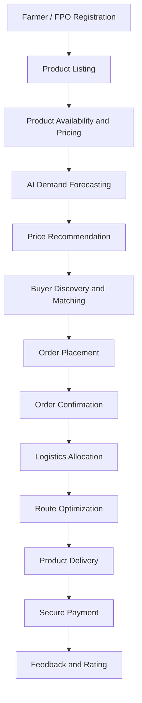
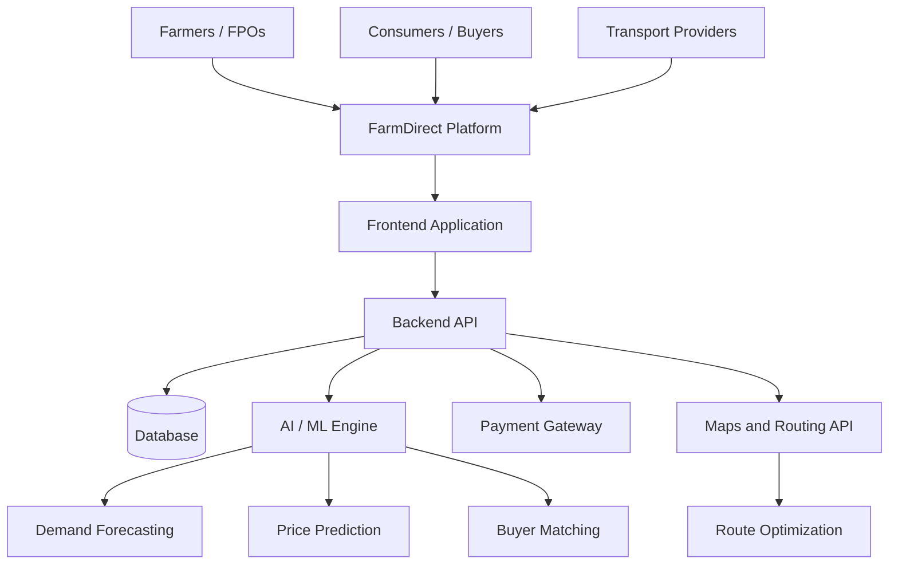

# 🌾 FarmDirect – AI-Powered Farmer-to-Consumer Marketplace

> **Smart India Hackathon 2026 | SIH 26033**  
> Connecting farmers directly with consumers and bulk buyers through AI-powered market intelligence and smart logistics.

---

## 📌 Project Information

| Field | Details |
|---|---|
| **Problem ID** | SIH 26033 |
| **Problem Title** | Multiple intermediaries reduce farmers' earnings and increase consumer prices |
| **Organization** | Ministry of Consumer Affairs, Food & Public Distribution |
| **Theme** | Agriculture, FoodTech & Rural Development |
| **Project Name** | FarmDirect |
| **Reference Number** | 26011473 |
| **Date** | 21/11/2026 |
| **Submitted By** | Aswanth K |

---

## 📖 Overview

FarmDirect is a digital agricultural marketplace that connects farmers, Farmer Producer Organizations (FPOs), consumers, retailers, restaurants, wholesalers, and bulk buyers directly.

The traditional agricultural supply chain involves multiple intermediaries, reducing farmers' profits while increasing prices for consumers. FarmDirect aims to minimize these inefficiencies by providing a transparent, technology-driven platform for agricultural trading.

The platform integrates **Artificial Intelligence (AI)** for demand forecasting, price recommendations, buyer matching, and logistics optimization to improve agricultural supply chain efficiency.

### 🎯 Mission

To empower farmers with better market access, fair pricing, and higher income while providing consumers with fresh agricultural produce at affordable prices.

---

## 🚨 Problem Statement

Multiple intermediaries in the agricultural supply chain create several challenges:

- Farmers receive lower prices for their produce.
- Consumers pay higher prices for agricultural products.
- Lack of transparent market information.
- Inefficient transportation and logistics.
- Increased post-harvest wastage.
- Limited access to direct buyers.
- Delayed payments and poor market connectivity.

FarmDirect aims to address these challenges by digitizing the agricultural marketplace and reducing unnecessary intermediaries.

---

## 💡 Proposed Solution

FarmDirect provides a centralized digital marketplace where farmers can list agricultural produce and buyers can directly purchase products.

The platform uses AI and data-driven technologies to optimize pricing, demand forecasting, buyer matching, and transportation.

### Key Features

- 🛒 **Direct Marketplace** – Connect farmers directly with consumers, retailers, restaurants, wholesalers, and bulk buyers.
- 💰 **Smart Price Discovery** – Compare market prices and buyer offers to support informed selling decisions.
- 🤖 **AI Demand Forecasting** – Predict agricultural demand using historical data, seasonal trends, and market activity.
- 🚚 **Integrated Logistics** – Connect farmers with transport providers and delivery services.
- 🗺️ **Route Optimization** – Generate efficient delivery routes to reduce fuel consumption and transportation costs.
- 📦 **Bulk Order Management** – Support large-scale purchases by hotels, supermarkets, restaurants, and wholesalers.
- 🌐 **Multilingual Interface** – Provide regional-language support for rural users.
- 🔐 **Secure Digital Payments** – Enable transparent payment tracking and digital transactions.
- 🌱 **Quality and Traceability** – Display product origin, harvest date, quality, and availability.

---

## ✨ Innovation and Uniqueness

FarmDirect combines agricultural e-commerce with AI-powered market intelligence and logistics optimization.

### Innovative Components

1. AI-powered demand prediction to help farmers plan sales.
2. Intelligent buyer-farmer matching based on location, quantity, and price.
3. Dynamic price recommendations based on market trends.
4. Smart logistics allocation to identify nearby transportation options.
5. Route optimization for efficient delivery.
6. Collective selling through FPOs to support small farmers.
7. Transparent pricing that displays product costs, logistics charges, and transaction details.

Unlike conventional marketplaces, FarmDirect focuses on optimizing the entire supply chain, from produce listing to final delivery.

---

## 🛠️ Tech Stack

### Frontend
- React.js / Next.js
- Flutter
- HTML
- CSS
- JavaScript

### Backend
- Node.js
- Express.js
- Python
- REST APIs

### Database
- PostgreSQL
- MongoDB

### AI / Machine Learning
- Python
- Pandas
- NumPy
- Scikit-learn

### Maps and Logistics
- OpenStreetMap
- OSRM (Open Source Routing Machine)
- Google Maps API
- GPS-based location services

### Authentication and Payments
- OTP Authentication
- Role-Based Access Control (RBAC)
- UPI Integration

### Cloud and Deployment
- Firebase
- AWS
- Docker
- GitHub

---

## ⚙️ System Workflow

---

## 🔄 Implementation Methodology

### 1. User Registration
Farmers, FPOs, buyers, consumers, and logistics providers register on the platform.

### 2. Product Listing
Farmers upload their produce details, including quantity, price, location, quality, and harvest date.

### 3. AI Market Analysis
The system analyzes market prices, historical demand, seasonal patterns, and buyer activity.

### 4. Buyer Matching
The platform recommends suitable buyers based on location, quantity requirements, product availability, and price preferences.

### 5. Order Placement
Buyers place orders directly with farmers or FPOs. Farmers can accept, reject, or negotiate offers.

### 6. Logistics Allocation
The system identifies nearby transport providers and recommends efficient delivery routes.

### 7. Delivery and Payment
Produce is delivered to the buyer, and payments are processed through the platform with transaction tracking.

---

## 🏗️ System Architecture

---

## 📊 Feasibility and Viability

### Technical Feasibility

The solution can be developed using widely available technologies, open-source frameworks, APIs, and cloud infrastructure.

AI models can initially be trained using publicly available agricultural market data and gradually improved using platform-generated transaction data.

### Economic Feasibility

The prototype can be developed with minimal infrastructure costs using free-tier cloud services and open-source software.

### Potential Revenue Models

- Small transaction-based service fees.
- Logistics commission.
- Subscription plans for bulk buyers.
- Premium market analytics.
- Partnerships with FPOs and agricultural organizations.

### Operational Feasibility

The platform can initially be introduced in a pilot region by onboarding farmers, local FPOs, buyers, and transport providers.

Farmers with limited digital literacy can be supported through FPO representatives and local agricultural facilitators.

---

## ⚠️ Challenges and Risk Mitigation

| Challenge | Proposed Solution |
|---|---|
| Low digital literacy | Simple UI and regional-language support |
| Lack of trust | Verified users, ratings, and transparent transactions |
| Inconsistent produce quality | Quality details, product images, and verification |
| Transportation difficulties | Integration with local logistics providers |
| Market price fluctuations | AI-assisted price recommendations |
| Limited initial user adoption | Pilot programs and FPO partnerships |
| Supply-demand imbalance | AI demand forecasting |

---

## 🌍 Impact and Benefits

### Economic Impact
- Increased farmer income.
- Reduced intermediary margins.
- Improved bargaining power.
- Lower procurement costs for buyers.
- Transparent agricultural pricing.

### Social Impact
- Improved market access for small and marginal farmers.
- Digital inclusion in rural communities.
- Empowerment of Farmer Producer Organizations.
- Increased transparency in agricultural trade.

### Environmental Impact
- Reduced transportation inefficiencies.
- Lower fuel consumption.
- Reduced post-harvest food wastage.
- Efficient utilization of agricultural resources.

### Expected Outcomes

- Better price realization for farmers.
- Affordable produce for consumers.
- Faster and transparent transactions.
- Reduced supply-chain inefficiencies.
- Improved agricultural market connectivity.

---

## 🔮 Future Scope

- Integration with government agricultural databases.
- IoT-based crop quality monitoring.
- Blockchain-based supply chain traceability.
- AI-based crop advisory services.
- Weather-based agricultural recommendations.
- Automated multilingual voice assistant for farmers.
- Integration with cold storage providers.
- Expansion to regional and national agricultural markets.

---

## 📚 Research and References

1. **National Agriculture Market (e-NAM)**  
   https://enam.gov.in/

2. **e-NAM – Farmer Information**  
   https://www.enam.gov.in/web/stakeholders-Involved/farmers

3. **OpenStreetMap**  
   https://www.openstreetmap.org/

4. **Scikit-learn**  
   https://scikit-learn.org/

5. **Open Source Routing Machine (OSRM)**  
   https://project-osrm.org/

6. **Ministry of Agriculture & Farmers Welfare, Government of India**

---

## 👨‍💻 Project Details

**Project Name:** FarmDirect  
**Hackathon:** Smart India Hackathon 2026  
**Problem ID:** SIH 26033  
**Theme:** Agriculture, FoodTech & Rural Development

---

## 🏷️ Tags

`SmartIndiaHackathon` `SIH2026` `Agriculture` `FoodTech` `RuralDevelopment` `AI` `MachineLearning` `AgriTech` `FarmerMarketplace` `SupplyChain` `FarmDirect`

---

> **FarmDirect – From Farm to Fork, Fair for Everyone.** 🌾
